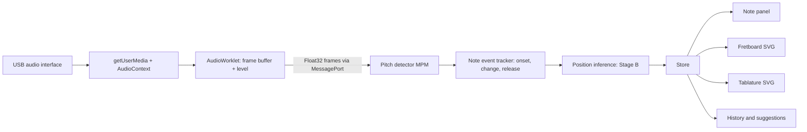
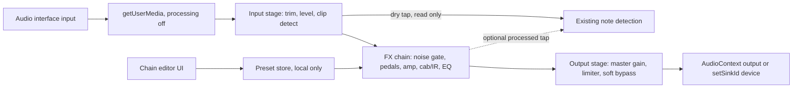

# Guitar Tracker - Implementation Plan

## Top-Level Overview

**Goal:** A browser-only web app (React + TypeScript + Vite) that captures audio from a USB audio interface, detects monophonic guitar notes in real time, shows them on a virtual fretboard and a live tablature, and is transparent about the limits of string/fret inference.

**Repository state (verified):** empty. Only `.git` exists, with no commits and no files. Everything is scaffolded from scratch. Package manager: **npm**. Platform: Windows / PowerShell.

**Confirmed design decisions**
1. **Pitch detector:** MPM (McLeod) as the primary algorithm. YIN is implemented as a reference in the DSP module, only for comparison in tests. **The analysis window is not fixed.** It is a configurable option with 2048, 4096 and, if measurements require it, larger values (8192). The hop is configurable too (initial candidate: 512). The default is chosen from measurements, not assumed. Every parameter is documented (effect and trade-off) and adjustable from the UI.
2. **Position inference (Stage B):** heuristic scoring based on proximity to the previous position, fretboard region, hand-shift distance and temporal continuity. Scores are *relative algorithm estimates*, not calibrated probabilities and not physical confirmation. The UI must say so explicitly.
3. **UI language:** pt-BR. State in React with hooks plus a small store (for example `useSyncExternalStore`). No Redux.
4. **Tablature:** SVG. Uncertain positions are visibly marked and can be corrected manually by click. ASCII export is prepared as an option in Phase 5.
5. **Playwright:** uses Chromium's fake audio device (`--use-fake-device-for-media-stream`, `--use-fake-ui-for-media-stream`). It tests only the UI and wiring, **not** real recognition.
6. **Independent confidences:** `pitchConfidence` (is the detected note right?) and `positionConfidence` / ambiguity state (is the string and fret right?) are separate fields in the types, the events, the store and the UI. They are never merged into one number. A correctly identified note does not imply its physical position was identified. The UI labels them separately. The reference image shows a single "Confiança 93%" card, so that card is labelled as note-detection confidence only, and the position card carries its own qualitative state.
7. **Faithful UI with honest placeholders:** the full reference layout is built in Phase 1. Any element not yet backed by a real engine is shown in an explicit "Indisponível" or "Em desenvolvimento" state. No placeholder value, sample note, sample history row or fake meter movement is ever shown. Static reference data (the standard tuning table) is real data and is fine.
8. **Audio-thread architecture, simplest reliable first:** start with the simplest arrangement that is stable, then measure before optimizing (see Open point below). Audio stability has priority over a theoretical latency reduction.
9. **Real validation is separate and gated:** a manual test procedure with a real guitar is written in Phase 1 (`docs/manual-validation.md`) and executed later by the user. Nothing in the app or docs says real recognition is validated until a result sheet is filled in.

**Non-negotiables from the brief**
- No simulated audio device and no fake detection data. Devices come from `navigator.mediaDevices`.
- No audio recording or transmission. No external APIs.
- Pitch (Stage A) and position (Stage B) are independent modules. Neither imports React.
- Do not claim real-world recognition works until tested with a real guitar. Document limitations.
- Do not advance a phase until its acceptance criteria and tests pass.

**Architecture (data flow)**



**Open point (settled by measurement in Phase 2):** where the detector runs. The candidates are:
- **A. Detector inside the AudioWorklet.** No Float32 block transfer. Risk: heavy work in the audio render thread (128-sample quantum) can cause glitches and dropouts, especially with 4096+ windows.
- **B. Worklet only buffers and posts blocks (transferable `Float32Array`) to the main thread, which runs the detector.** Simplest to build and debug. Risk: main-thread contention and message traffic.
- **C. Worklet posts blocks to a dedicated Worker (optionally through `SharedArrayBuffer` ring buffer).** Keeps main thread free. Risks: transfer cost, and `SharedArrayBuffer` needs cross-origin isolation headers (COOP/COEP).

Plan: start with the simplest reliable option, **B with a Worker-ready interface** (the detector is a pure function over a `Float32Array`, called through a small `PitchEngine` interface that can later be hosted in the main thread, a Worker or the worklet). Measure first: block transfer rate and bytes per second, per-frame detection time for each window size, main-thread long tasks, dropped or glitched blocks, and CPU. Move to a Worker or the worklet only if numbers show a real problem. Record the numbers in `docs/performance.md`. Never trade audio stability for latency that exists only on paper.

**Target module layout** (the repo is empty, so the suggested layout is adopted)

```
index.html, package.json, tsconfig*.json, vite.config.ts, vitest config, playwright.config.ts
public/                      (worklet file only if it cannot be bundled by Vite)
docs/                        (detection parameters, latency measurements, limitations)
src/
  audio/        devices, capture session, worklet loader, error mapping
  dsp/          preprocessing, MPM, YIN (reference), confidence, onset/silence gating
  music/        frequency<->note, tuning model, fretboard note map, note naming (pt-BR)
  inference/    candidate generation, scoring, temporal context
  fretboard/    SVG fretboard geometry and rendering
  tablature/    event recording, dedup, durations/rests, ASCII export
  components/   header, panels, meters, controls
  hooks/        bridge between UI and the audio engine
  types/        shared types and event contracts
  styles/       theme tokens (dark navy, green, blue)
tests/          unit tests (Vitest) and e2e (Playwright)
```

---

## Sub-Tasks

### Phase 1 — Project structure and audio capture

**Intent:** Establish a working toolchain, the visual shell from the reference image, and real audio capture (device listing, start/stop, level meter, error handling). No pitch detection yet.

**Expected Outcomes**
- `npm run dev`, `build`, `test` and `lint`/typecheck all work.
- The app shows the **complete reference layout** (header, Audio panel, tuning panel, four status cards, fretboard area, tablature area, history, suggestions, tips) in the dark navy theme.
- Every not-yet-functional element is explicitly labelled "Indisponível" or "Em desenvolvimento" and contains no invented data: no sample note, no fake history rows, no fake percentages, no animated meter unless driven by real samples. The Phase 1 fretboard may draw the real geometry statically only if it shows no highlighted note.
- The tuning table shows the real standard-tuning reference values.
- Real input devices are listed through `enumerateDevices`. The user can pick one, press start or stop, and see a live level meter driven by actual samples.
- Permission denied, no device, device unplugged mid-session, and `AudioContext` suspended are each handled with a clear pt-BR message and reconnect instructions.
- Capture can be stopped immediately, and the mic tracks are released.
- A visible "capture active" indicator is shown. A privacy statement says audio is never recorded or sent.

**Todo List**
1. Scaffold Vite + React + TypeScript with npm. Add Vitest, Testing Library (jsdom) and Playwright. Add ESLint and a typecheck script.
2. Define theme tokens (navy background, panel blues and greys, green for current note, blue for alternatives) and the base layout grid. Pick one modern font via a local or self-hosted approach, with no external CDN dependency.
3. Build the shell components: header with logo icon (SVG), title, subtitle, connection status and settings button; Audio panel; Tuning panel; and the full-size containers for the note cards, fretboard, tablature, history, suggestions and tips, each with a reusable "unavailable / in development" state component. The note card and the position card show separate fields for note-detection confidence and position confidence, both unavailable in Phase 1.
4. Implement `src/audio/` modules: device enumeration with a `devicechange` listener, capture session (`getUserMedia` with echo cancellation, noise suppression and auto gain **off** by default, because they distort pitch; document why), `AudioContext` lifecycle, a typed error mapping layer.
5. Implement the `AudioWorklet` processor that computes a level measure (RMS and peak per block, from real samples) and forwards it to the main thread. Do not stream raw blocks yet, because Phase 1 does not need them. Set `latencyHint: 'interactive'` and record `baseLatency` and `outputLatency` for later reporting. Keep the processor free of heavy work.
6. Hook (`useAudioCapture`) exposing state: idle, requesting, active, error(kind), plus level and device list.
7. Wire the level meter, sensitivity slider, window size slider and noise filter toggle to state. The sliders are stored but only consumed from Phase 2.
8. Add the permission explanation shown before the first request.
9. Tests: error mapping unit tests, device-list logic with a mocked `mediaDevices` (mocks are for testing only, never in the app), a Playwright smoke test with the Chromium fake device for start, stop and the meter moving.
10. Write the README run/test section and a short `docs/` stub.
11. Write `docs/manual-validation.md`: a real-guitar test procedure and result sheet (see "Manual validation protocol" below). It is executed by the user later and is not marked as passed.
12. Report to the user: results of `build`, typecheck, lint and tests, problems found, and a demonstration of real device capture and the live level meter (a dev-server run plus Playwright fake-device evidence, and clear instructions for the user's own check with the real interface). **Stop after Phase 1 and wait for approval.**

**Relevant Context**
- Reference image defines the layout: header, 260–300 px left column (Audio, Tuning), right column with four status cards, fretboard, tablature, then history / suggestions / tips in three columns.
- Brief sections 3, 4 (header, Audio panel), 8, 9, 10.
- AudioWorklet files need correct bundling with Vite (`new URL(..., import.meta.url)` or `?worker&url`). Verify this on `build`, not just `dev`.
- The app must be served over `localhost` or HTTPS for `getUserMedia`.

**Acceptance criteria:** `build`, typecheck, lint and tests pass; a manual run lists a real device; the meter reacts to real input; unplugging the device shows an error and recovery path; no fake data appears anywhere in the UI; results are presented to the user before Phase 2 starts.

**Status:** `[x] done` (awaiting user review)

**Handoff notes for Phase 2**
- `src/audio/level-processor.worklet.ts` only computes RMS/peak; no Float32 blocks are transferred yet. Phase 2 adds a block-forwarding path behind a `PitchEngine` interface (option B in the Open point).
- `CaptureSettings.sensitivity`, `windowSize` (2048/4096/8192) and the settings UI exist but have no effect yet.
- `src/music/` has only `midiToFrequency`, `midiToScientificName` and `STANDARD_TUNING`. Frequency->note, cents and pt-BR names are still to be written.
- The fretboard in `FretboardPanel.tsx` draws real geometry (`src/fretboard/geometry.ts`) with no highlighted note. Fret numbers 22 to 24 are crowded at the top; revisit in Phase 6.
- Browser reported 96 kHz sample rate on the fake device. Window durations must be computed from the real `sampleRate`, not assumed 48 kHz.
- E2E uses Chromium's fake device (synthetic beeps). It validates wiring only.
- Real-guitar validation (`docs/manual-validation.md`) has NOT been executed.
- User hardware: M-Audio M-Track Duo (2 input channels) with Reaper and ASIO4ALL on Windows. See `docs/windows-audio-setup.md`. Capture currently requests `channelCount: ideal 1`; with a 2-channel interface this may read only input 1 or a downmix. Pending the user's test, Phase 2 must start with a channel selection (input 1, 2 or sum) and a per-channel meter, so the detector receives the correct channel.

---

### Phase 2 — Real note detector and tests

**Intent:** Build a pure, testable DSP engine that turns sample blocks into structured note events, running in real time off the main thread.

**Expected Outcomes**
- `src/dsp/` pitch detection returns frequency, clarity/confidence and processing time per frame.
- A note-event layer produces `onset`, `pitch-change`, `sustain`, and `release` events, with silence handling and hysteresis.
- Metrics: measured detection latency (onset to event) and per-frame processing cost, displayed in the "Tempo real" card and documented.
- Detector behavior on the known problem cases is characterised in tests and docs.

**Todo List**
1. Types in `src/types/`: `PitchFrame`, `NoteEvent` and `EngineConfig`.
2. Preprocessing: DC removal, light high-pass (below the low E fundamental, about 82 Hz), optional low-pass and optional soft pre-emphasis. Document each parameter and its effect.
3. MPM implementation (normalized square difference function, peak picking, parabolic interpolation, clarity threshold). Implement YIN as a reference in the same folder.
4. Octave error and harmonic handling: bias towards the lowest strong peak, key-maximum threshold tuning. **Window size is configurable (2048, 4096, optionally 8192), not fixed.** Run the same test and benchmark suite for every window size and, for each one, document accuracy (cents error and octave-error rate for E2 through the low register, and for mid/high notes) and latency. Reference arithmetic to verify by measurement: at 48 kHz, 2048 samples is about 42.7 ms and 4096 about 85.3 ms of audio; E2 (82.41 Hz) has a period of about 12.1 ms, so a 2048 window holds about 3.5 periods and a 4096 window about 7 periods. The choice of default, and whether to offer an automatic window choice by detected register, is decided from the measured numbers.
5. Silence and gating: RMS threshold derived from the sensitivity slider, hysteresis, minimum clarity, noise floor estimation.
6. Event logic: onset detection by energy rise, pitch-change detection with a semitone hysteresis and cents tolerance (vibrato must not create new notes), repeated-same-note re-attack detection through energy envelope, minimum note duration, release detection.
7. Handling for distortion, palm mute and short notes: record the observed behavior, apply conservative handling (lower confidence rather than invent data), and document it.
8. Run the detector behind a `PitchEngine` interface, starting with the simplest reliable arrangement (option B in the Open point above: worklet posts transferable `Float32Array` blocks, the detector runs off the audio thread). Publish frames and events to the store. Throttle UI updates with `requestAnimationFrame`, separate from detection rate.
8b. Performance measurement before any optimization: bytes and messages per second for the Float32 transfer, per-frame detection time per window size, main-thread long tasks, audio glitches/dropouts, CPU and memory over a few minutes. Only if the numbers show a real problem, try option C (Worker, and `SharedArrayBuffer` only if cross-origin isolation is acceptable) or option A. Document the numbers and the decision in `docs/performance.md`.
9. Latency measurement: timestamps from the worklet frame time to event emission, plus the structural window latency (time needed to fill the window). Report both clearly, and do not confuse them with the UI frame rate.
10. Note panel (name in pt-BR with octave, such as "Fá (F4)", Hz, confidence bar, silence state) driven by real events. Tuning panel shows the standard tuning reference.
11. Tests (synthetic signals): the six open strings; known notes across the range (E2 to about E6); sine, sawtooth and harmonic-rich waveforms with a weak fundamental; additive noise at controlled SNR; vibrato (±20–50 cents); amplitude changes; silence, DC and clipped/invalid input; note changes; repeated attacks; octave-error cases; MPM versus YIN comparison.
12. `docs/detection.md`: parameter table (effect, trade-off, default), a per-window-size table (2048 / 4096 / larger) of measured accuracy and latency with E2 and low notes called out, CPU notes, known limitations.

**Relevant Context**
- Brief sections 5, 6, 8, 11.
- Synthetic tests validate the algorithm only. Real guitar testing is a separate manual step.
- `music/` basics (frequency↔note, cents) are needed here, so create the minimum of `src/music/` in this phase (it is completed in Phase 3).

**Acceptance criteria:** all DSP tests pass for each supported window size; measured performance numbers are documented; the detector reports plausible notes for a real guitar in a manual session (executed by the user per `docs/manual-validation.md`), with observed problems written in `docs/`. Real recognition is not declared validated until that sheet is filled in.

**Status:** `[x] done` for the automated scope (awaiting user review). **Real-guitar validation is NOT done** (`docs/manual-validation.md`, cases 1-7 and 9-16 are now applicable).

**What was built:** `src/dsp/` (FFT autocorrelation, MPM, YIN reference, biquads, `NoteTracker`, `PitchEngine`, documented `defaults.ts`), `src/audio/capture-processor.worklet.ts` (10 ms mono blocks, transferable, channel mode 1/2/sum, per-channel levels), `src/audio/engine-host.ts` (stats + measured latency), live note/frequency/confidence/latency cards, channel selector with per-channel bars, working sensitivity/window/detector-filter controls (window and filter swap the engine live). Old `level-processor.worklet.ts` removed.

**Measured (synthetic, 48 kHz):** 49/49 notes E2-E6 correct for 2048/4096/8192 in all scenarios (clean, SNR 20/10/0 dB, weak fundamental, distorted spectrum); 0 octave errors, 0 extra events. Latency 28-65 ms audio time (not window-dependent in this test). 8192 loses fast 80 ms notes (1/8). CPU 2.6% / 4.5% / 9.7% of audio time in Node. Browser (fake device): 100 blocks/s, 188 KiB/s, 0 long tasks. See `docs/detection.md` and `docs/performance.md`.

**Not measured / known gaps:** any real guitar; audio glitches and CPU/memory over minutes in the browser; hardware/driver latency; palm mute and distortion behavior on real signals; whether latency depends on window size with real background noise.

**Handoff notes for Phase 3**
- `ActiveNote` / `NoteEvent` carry `midi`, `frequency`, `cents`, `pitchConfidence`. There is NO position or position-confidence field yet; Phase 4 must add it separately (do not reuse `pitchConfidence`).
- `src/music/notes.ts` has `frequencyToNote`, `midiToPtName`; Phase 3 adds the tuning-based note-to-fret map and the highlighted fretboard.
- The hook exposes `events` (max 500, includes releases), `live`, `lastNote`, `stats`; Phase 5 consumes `events`.
- Tests in `tests/unit/detector.test.ts` run per window size and take about 15 s in total.

---

### Phase 3 — Virtual fretboard and mathematical mapping

**Intent:** Provide the tuning model and note-to-fret math, and render the interactive SVG fretboard.

**Expected Outcomes**
- Tuning is a data structure (strings with MIDI notes), standard tuning E2 A2 D3 G3 B3 E4 by default, and ready for alternative tunings later.
- Correct mapping of every string and fret to MIDI note, frequency and name for a configurable fret count (24 by default).
- SVG fretboard with six strings, numbered frets, inlay markers (3, 5, 7, 9, 12 double, 15, 17, 19, 21, 24 double), string labels, a proportional fret spacing (equal-temperament scale-length rule), a legend, and highlight of the current note (green) and alternative positions (blue).
- The fretboard is a pure rendering component with no audio logic.

**Todo List**
1. `src/music/`: `frequencyToNote`, `noteToFrequency`, cents deviation, pt-BR note names with octave, A4 reference configurable (440 Hz default), tuning model, `getPositionsForMidi(note, tuning, fretCount)`.
2. Fretboard geometry module (fret positions, string spacing, marker positions), separate from the React component.
3. SVG component with the visual style from the reference (wood-toned board, nut, metal frets, glow for the current note). Fret count prop. Smooth transitions kept cheap.
4. Legend and fret count control in settings.
5. Connect the fretboard to the latest detected note. Until Phase 4 it shows all compatible positions with no preference ranking and is marked as such.
6. Tests: frequency↔note round trips; the 6 open strings at 82.41, 110.00, 146.83, 196.00, 246.94, 329.63 Hz; every string × fret map for 24 frets (and other counts); notes with multiple positions (for example E4 has 6 candidates up to fret 24 in standard tuning, verify by the test rather than by hand); out-of-range notes return no candidate; fretboard geometry monotonic and proportional.

**Relevant Context**
- Brief sections 4 (fretboard), 6, 7 (Stage A / B separation), 11.
- Note: the reference image shows "Fá (F4) → 1ª corda, 1ª casa", which matches E4 + 1 semitone. Use it as a sanity check.
- The reference shows string labels e B G D A E top to bottom. Keep that visual order, with internal indexes 1ª–6ª.

**Acceptance criteria:** tests pass; fretboard renders correctly at 12, 22, 24 frets; highlighted positions agree with the math.

**Status:** `[x] done` for the automated scope (awaiting user review). Real-guitar check of the fretboard is case 17 in `docs/manual-validation.md` (NOT executed).

**What was built:** `src/music/fretmap.ts` (`buildFretMap`, `getPositionsForMidi`, `playableRange`; fret count 1-36 validated), `src/fretboard/layout.ts` (pure SVG coordinates), `src/components/FretboardSvg.tsx` (pure rendering: strings, numbered frets, inlays, nut, open-string circles, green/blue markers), `FretboardPanel` (fret count selector 12/21/22/24, default 24, summary line, wired to the live note while capturing). Old inline SVG removed.

**Decisions:** the math returns ALL compatible positions in string order, with no preference. Green is used only when a note has exactly one possible position (e.g. E2 = 6th string open); with several positions nothing is drawn by default; all are blue only when the user turns on the "Mostrar outras posições" switch (off by default, local state of FretboardPanel). Nothing is shown as "the played position" before Phase 4. Tuning is a parameter (tested with Drop D); the UI offers only standard tuning.

**Tests:** 153 unit (48 new: round trips, A4 reference, 150 string x fret combinations, +1 semitone per fret, fret 12 = octave, E4 has 6 positions at 24 frets / 5 at 22 / 3 at 12, F4 = 1:1 2:6 3:10 4:15 5:20, out-of-range, layout monotonic, component marker rendering) and 6 E2E. Visual check by screenshot for F4/24, E2/24, E4/12, E6/24.

**Known gaps:** fret numbers 22-24 are crowded at 24 frets; no manual position selection; no real-guitar check of this phase; the Phase 6 settings modal does not exist yet (fret count lives in the fretboard header).

**Handoff notes for Phase 4**
- `getPositionsForMidi(midi, tuning, fretCount)` returns `FretPosition[]` (`stringNumber`, `stringIndex`, `fret`, `midi`, `frequency`, `name`). Phase 4 ranks these; keep `positionConfidence` separate from `pitchConfidence`.
- `FretboardPanel` currently takes only `midi`. Phase 4 should pass `FretMarker[]` (primary = green, alternatives = blue) so the panel stops deciding colors itself.
- The "Posição estimada" card and the suggestions panel are still placeholders.
- Extra (requested during Phase 3 review): a tuner tab (`src/music/tuner.ts`, `TunerPanel.tsx`, `useAudioCapture().tuner`) that shares the capture and detector; it inherits the detector's silence gate and clarity (0.80), so a very soft low E may not show. The Audio panel has a "Portão de silêncio" diagnostic line (`openDb`/`noiseFloorDb`/`clarity` on `PitchFrame`/`LiveDetection`). Low-E sensitivity on a real guitar is unresolved and unverified; check manual-validation case 18 before changing detector parameters.

---

### Phase 4 — Position inference and ambiguity handling

**Intent:** Implement Stage B: ranking candidate positions using context, and expose uncertainty honestly.

**Expected Outcomes**
- Each note event gets a ranked candidate list with relative scores.
- The result carries an explicit ambiguity state (for example `confident`, `ambiguous`, `unknown`) determined by the score margin and context availability.
- The nearest position is never auto-assumed correct.
- UI shows the primary guess (green), alternatives (blue), and the suggestions panel with a permanent notice that scores are algorithm estimates, not probabilities or physical confirmation.
- The module is structured with an input interface that other evidence sources (sensors, computer vision) could feed in later.

**Todo List**
1. Define the `PositionEvidence` interface and the `PositionCandidate` / `PositionInference` types. Keep audio-only inference as one implementation, so extra evidence can be added later.
2. Scoring factors, each documented and weighted through a config object: distance from the previous position (hand shift), preference for staying in the current hand region, string-change cost, open-string handling, general playability region, temporal consistency over a sliding window of recent notes, and a penalty for jumps with short gaps.
3. Ambiguity rule: margin between the top candidates below a threshold, or no context, gives `ambiguous`. Define the thresholds in the config and document them.
4. Contextual re-evaluation: allow a later note to refine the interpretation of the previous run (optional, bounded and clearly marked). Decide in implementation whether it is worth the complexity. If not, record that decision in the docs.
5. Suggestions panel (reference style): ranked list, relative score shown as a percentage-like bar with an "estimate" label and the permanent disclaimer.
6. Update the "Posição estimada" card with a qualitative label ("com alta confiança" only when the state is `confident`; "ambígua" otherwise).
7. Tests: single-candidate notes; multi-candidate notes with and without context; scale runs in one position and across positions; large jumps; open strings; ambiguity state transitions; determinism; scores sorted and bounded.

**Relevant Context**
- Brief section 7 and the "Sugestões de posições" requirement.
- Pitch confidence (Stage A) and position confidence (Stage B) are different values and must be shown separately in the UI.

**Acceptance criteria:** tests pass; ambiguous notes are visibly flagged; no UI text implies physical certainty.

**Status:** `[x] done` for the automated scope (awaiting user review). Real-guitar check of the inference is case 8 in `docs/manual-validation.md` (NOT executed). Details in `docs/inference.md`.

**Decisions:** the nearest position is not favoured by default (hand shift is one factor and needs context). First note / after a >4 s pause is always `ambiguous`, shown as the best estimate in light-green dashed with the others hidden behind the "Mostrar outras posições" switch (user decision). `positionConfidence` is an algorithm index capped at 0.9 (0.25 without context), separate from `pitchConfidence`. No re-evaluation of past notes (recorded in the docs; manual correction in Phase 5 covers it). `ExternalEvidence` is the hook for sensors/vision/manual overrides. The `fretCount` state lives in `App` so the inference context resets when it changes.

**Tests:** 234 unit (+33: states, determinism, bounded scores, context, jumps, timeouts, Drop D, external evidence, synthetic audio -> detector -> inference, components) and 8 E2E. Weights were tuned only on synthetic sequences.

**Known gaps:** heuristic not calibrated with a real guitar; wrong guesses are possible after legitimate large jumps or alternating-string arpeggios; no manual correction yet (Phase 5); tablature/history still placeholders.

**Post-Phase-4 adjustment (user feedback): fretboard region.** Real use showed G3 played on string 4 / fret 5 appearing as open string 3 (same pitch, no context). Added a user-declared region (`FretRegion`, switch "Informar região do braço", off by default) that restricts candidates; a single remaining candidate due to the region is `confident` (not `unique`) and labelled as user-provided. Phase 5 should reuse it: manual per-note corrections go through `ExternalEvidence`, and the region should be kept when the history is cleared.
**Handoff notes for Phase 5**
- `useAudioCapture(fretCount)` exposes `lastInference` (a `PositionInference` per onset/change event). The tablature recorder should consume note events plus their inference and store `state`, `candidates` and `positionConfidence`; uncertain (`ambiguous`) entries must be visibly flagged and be correctable by choosing another candidate (store as manual override).
- `PositionInferrer.observe` accepts `NoteObservation.evidence` so a manual override can feed later notes as `ExternalEvidence`.
- Placeholders still to replace: `TablaturePanel`, `HistoryPanel` in `src/components/Panels.tsx`.

---

### Phase 5a — Temporal decoder (beam search) — APPROVED SCOPE

Approved by the user after an external review (see "PROPOSED REVISION OF STEP B" at the end of this file). Only 5a is in scope now; 5b (tablature, history, click correction) and 5c (collection mode / timbre feasibility) are NOT started, and timbre calibration is not implemented. The pending tuner reading for the open G string and the "Portão de silêncio" readings for the low E string are untouched.

**Approved criteria**
1. Keep existing tests; add regression tests for the already-evaluated synthetic sequences.
2. Revise earlier notes when later observations bring enough evidence, without forcing a position when ambiguous.
3. Declared region = strong preference, not a hard filter; flag when the best alternative is outside it.
4. The first note after a pause is not treated as resolved without enough evidence.
5. Separate acoustic score, musical plausibility and transition cost.
6. Flag revised positions in the UI.
7. Define objective accuracy, ambiguity and latency tests before calling the phase done.

**Implemented** (`src/inference/`): `region.ts`, `factors.ts` (shared pieces), `costs.ts` (acoustic = 0, evidence, musical, transition), `decoder.ts` (`SequenceDecoder`, beam width 24, window 16, hysteresis `revisionMargin` 0.1), `DecoderConfig` in `config.ts`. `useAudioCapture` now uses the decoder and exposes `revisions`. `FretboardPanel` shows "Posição revisada" and the "FORA da região" warning. `rankPositions` / `PositionInferrer` are kept as the baseline for comparison.

**Objective tests** (`tests/unit/decoder.test.ts`, 32 tests, plus 3 UI tests in `fretboard-panel.test.tsx`): regression of the old sequences; accuracy on synthetic fingerings (decoder >= baseline; "estimada" notes >= 90% precise live; overall exact accuracy asserted to stay below 60% on validation so claims stay modest); ambiguity (first note after a pause stays ambiguous, no context carried over, confidence caps); revision (happens, keeps pitch, rare < 2% of notes on random sequences); separated costs; region as preference; external evidence outweighs context; latency (median < 1 ms, p95 < 5 ms) and bounded memory (<= 1000 records, window <= 16).

**Measured (synthetic only, NOT a real guitar):** exact string+fret accuracy tuning set 19/28 vs 17/28 baseline; validation set 16/37 (43%) vs 14/37 baseline. Main gain is calibration: with `confidentMargin` 0.2 the notes labelled "estimada" were 100% correct on these data (65-82% with 0.10), at lower coverage. Decoder step latency ~0.06 ms median, ~0.16 ms p95 in Node.

**Decisions that still depend on validation (real guitar)**
- All decoder weights (`weightStringCohesion` 0.15, `weightRegion` 0.4, `handFollow` 0.6, `openStringReachFactor` 2, `userRegionPenalty` 0.6, `confidentMargin` 0.2) were tuned on hand-written synthetic fingerings; `confidentMargin` was chosen looking at both sets, so validation numbers are optimistic.
- Whether 0.2 is the right margin in practice; whether revisions are more or less frequent on a real guitar; the 16-note window and 24-wide beam are defaults, not measured optima.
- Acoustic cost is 0 by design; using timbre depends on the Phase 5c experiment.
- Known limit: an isolated note, or the first after a pause, stays ambiguous; the decoder cannot create information that is not there.

**Status:** `[x] implemented; automated validation passed (typecheck, lint, 278 unit tests, 9 E2E, build). Real-guitar behaviour NOT validated; awaiting user feedback before 5b.`

---
### Phase 5 — Real-time tablature and history

**Intent:** Record events into a six-line SVG tablature and a history list, with deduplication, rests, durations, uncertainty marking, pause, clear, and review.

**Expected Outcomes**
- Tablature of six lines, with notes in correct temporal order, fret numbers at the estimated positions, and sustained notes recorded once.
- Repeated same-note attacks appear as separate entries.
- Rests and approximate durations shown.
- Uncertain positions are visibly flagged (for example hollow or dashed marker, with a "?" style indicator) and can be corrected by clicking an entry and choosing another candidate. Corrections are stored as manual overrides, kept distinct from automatic inference.
- Pause/resume recording, clear, scroll back through history, "last notes" and columns selector as in the reference.
- History list (time, note, Hz, string/fret, confidence).
- ASCII tablature export prepared, with a basic working implementation if it stays small.

**Todo List**
1. Tablature recorder in `src/tablature/` that consumes note events only (not DSP internals): dedup of sustain, new entry on onset or on a pitch change, duration from onset to release, rest insertion by silence length thresholds, quantization to coarse buckets (document that it is approximate).
2. Entry model: id, timestamp, midi, frequency, confidence, chosen candidate, alternatives, ambiguity state, manual override flag.
3. SVG tablature component with column grouping (4 columns option from the reference), highlight of the latest note, uncertain-note styling, click to correct.
4. History panel and pause/clear/review controls. Cap stored history to bound memory.
5. ASCII exporter (6 lines, fixed-width columns, rests, uncertain marks) and a "copiar / baixar" action, using a local file download only.
6. Tests: sustain dedup; repeated attacks; rests and durations; ordering; uncertain marking; manual correction; clear/pause behavior; history cap; ASCII export snapshot.

**Relevant Context**
- Brief section 4 (tablatura, histórico).
- Tablature never records a position as confirmed when state is not `confident`.

**Acceptance criteria:** tests pass; with the Playwright fake device the tablature and history components mount and controls work; real-guitar behavior is documented after manual testing.

**Implemented (5b):** `src/tablature/` (`recorder.ts`, `quantize.ts`, `layout.ts`, `ascii.ts`), `src/types/tablature.ts`, `TablaturePanel` / `HistoryPanel` (replaced the placeholders), `useAudioCapture` exposes `tabItems`, `tabPaused`, `setTabPaused`, `correctTab`; `clearEvents` also clears the tablature. `SequenceDecoder` gained `applyEvidence`, `breakContext` and `latest`. Details in `docs/tablature.md`.

**Tests:** `tests/unit/tablature.test.ts` (34), `tests/unit/tablature-panel.test.tsx` (10), 1 new E2E (fake device). Total 322 unit + 10 E2E.

**Known limits:** manual correction only influences the decoder for notes still in its 16-note window; durations are coarse buckets, not rhythm; nothing validated on a real guitar (manual case 20, no result sheet filled in).

**Status:** `[x] implemented; automated validation passed (typecheck, lint, 322 unit tests, 10 E2E, build). Real-guitar behaviour NOT validated; awaiting user feedback before 5c.`

---

### Phase 6 — Visual refinement, performance, tests and documentation

**Intent:** Polish, measure, harden and document.

**Expected Outcomes**
- The interface matches the reference's visual hierarchy, responsive on desktop and tablet, with smooth non-blocking animations.
- Settings panel for engine parameters (window size, hop, thresholds, A4 reference, fret count) with descriptions of effects.
- Measured and recorded: detection latency, processing time per frame, CPU and memory observations, UI frame rate, each per configuration, with limitations stated.
- Tips panel content aligned with brief section 4.
- Full test suites green; end-to-end tests cover start/stop, device errors and the main panels.
- Documentation complete.

**Todo List**
1. Visual pass against the reference (spacing, colors, glow, status indicators) with no emojis, using SVG icons.
2. Responsive layout checks (desktop and tablet widths).
3. Settings modal for engine and display parameters with reset-to-defaults.
4. Performance pass: avoid re-render storms (throttled store updates, memoized SVG), profile the main thread, check memory over a long session.
5. Playwright suite: layout renders, start/stop with the fake device, permission-denied and no-device flows, settings changes, tablature clear/pause, responsive screenshots.
6. Docs: `README.md` (install, run, test, browser support, privacy), `docs/detection.md`, `docs/inference.md`, `docs/performance.md` (measured values only), `docs/limitations.md` (monophonic audio cannot confirm fret position, distortion, palm mute, low notes, vibrato, interface latency, browser audio processing), and update `docs/manual-validation.md` with any procedure changes.
7. Final full run of lint, typecheck, unit tests, e2e tests and production build.

**Relevant Context**
- Brief sections 3, 8, 10, 11 and "Resultado final esperado".
- Do not state that real recognition works unless it was tested with a real guitar. The docs must record what was and was not tested.

**Acceptance criteria:** all automated checks pass; docs contain measured numbers and honest limitations; a real-guitar manual session is recorded, or its absence is explicitly stated.

**Status:** `[ ] pending`

---

### Phase 7 (STARTED AT USER REQUEST: monitoring proof of concept + minimal studio) — Browser Guitar Amp & Effects Studio

**Status:** `[-] partial`. At the user's explicit request (hear the guitar; new tab for effects, amp, cabinet, mixer, output) a monitoring PoC and a minimal studio were implemented in `src/fx/`, `src/hooks/useStudio.ts` and `src/components/studio/`; see `docs/studio.md`. The detector and the Tracker/Tuner tabs are unchanged. **Not validated with a real guitar; latency NOT measured.** Everything below the next paragraph is the original plan and is still the reference for what is NOT done (reordering, presets storage, more pedals, IRs, worklet effects, loopback measurement, cross-browser list).

**What the PoC covers:** one shared AudioContext; parallel branch from the capture source; output off by default and enabled by an explicit click; master -18 dB; stateless soft limiter (0.98 ceiling); smoothed parameters; equal-gain crossfade per block; drive, EQ, amp (3 neutral voicings), cabinet (2 neutral sizes), delay, reverb (synthetic IR); output-device selection via `setSinkId` when supported; input/output meters; honest latency section; `src/fx` <-> `src/dsp` import boundary test. **What it does not cover:** the gate items in "Required gate" that need real hardware (loopback round-trip latency, CPU/dropouts over time, unplug behaviour, per-browser results) are pending in manual case 21.

**Loopback latency meter (added at user request):** `src/fx/loopback*.ts` plays 10 irregularly spaced clicks straight to the destination (bypassing the effects) and times their return through the input on the AudioContext clock. Irregular spacing was added after the Chromium fake device's periodic beeps produced false constant latencies. Analysis validated with known synthetic delays (error < 0.7 ms); NO real measurement recorded yet (manual case 24).

**Noise/hiss at high gain (added at user request):** noise gate (envelope follower with 5 ms look-ahead, threshold control, measure-background-noise button) before the drive, plus pre-saturation low-pass filters, post-saturation 24 dB/oct low-pass and a DC blocker in drive and amp. Measured offline with synthetic signals only (gate closes the gap noise, costs earlier note tails and +5 ms while on). NOT validated with a real guitar: manual case 23.

**Song-driven auto setup (added at user request):** the user picks a LOCAL audio file; `src/fx/music-analysis.ts` measures spectrum and decay in the browser and `src/fx/auto-config.ts` applies amp/cabinet/drive/reverb automatically (with Undo). Heuristic thresholds, NOT calibrated with real recordings; measures the whole mix, not the guitar; YouTube links are impossible in a browser (documented). Never changes output on/off, master, input channel or trim. Pending real-world check: manual case 22.

**Original status text:** idea registered; nothing here is a promise of results.

**Intent:** turn the site into a real-time electric-guitar processor, similar in purpose to using REAPER with amp simulators and pedals, running entirely in the browser: capture the guitar from the chosen audio interface, process it with a chain of virtual effects and amp/cabinet models, and play the result on a chosen output (for example a headset).

**Planned requirements (as requested)**
1. Capture the guitar from the user-selected interface through the browser audio APIs.
2. Play the processed signal on a user-selected output device.
3. Modular real-time engine: Web Audio API + AudioWorklet, and WebAssembly only where technically justified (measured, not assumed).
4. Virtual pedals, later: overdrive, distortion, fuzz, compressor, noise gate, chorus, flanger, phaser, wah, delay, reverb.
5. Amp simulation, EQ, virtual cabinets and loading of impulse responses (IRs).
6. Enable, disable, reorder and configure effects; custom chains; save presets.
7. Show available input and output devices, input level, clipping, connection state, and buffer/latency settings.
8. Audio stays local; nothing is uploaded to servers.
9. Later, feed the processed (or dry) audio into the existing note detection and tablature.

**Facts about the current code that matter (verified in the repo)**
- `src/audio/capture-session.ts` calls `getUserMedia` with `echoCancellation: false` and creates `new AudioContext({ latencyHint: 'interactive' })`. The capture graph is **input only**: nothing is connected to `AudioContext.destination`, so today the app produces no sound. Monitoring is new work, not a toggle.
- The detector chain (`src/dsp`, `src/audio/engine-host.ts`) consumes frames from a capture worklet and does not know about output. This separation must be preserved.

**Dependencies**
- Phases 5b and 6 should be finished or explicitly deprioritized by the user; this phase must not delay or destabilize detection work.
- The stable capture layer from Phase 1 (device listing, permission errors, disconnect handling) is reused, extended with output-device selection.
- A decision on whether the effects engine shares the detector's `AudioContext` (one context, one clock) or uses its own (isolation, but two audio clocks and extra latency). To be settled by the proof of concept with numbers.

**Proposed architecture (decoupled from note detection)**



- New module tree, no imports in either direction between `src/fx/` and `src/dsp/`: `src/fx/` (graph, nodes, presets, IR loader), `src/fx/worklets/` (AudioWorklet processors), `src/fx/wasm/` (only if justified), `src/components/studio/` (UI). Shared types live in `src/types/`.
- Effect interface: `process` over audio blocks, parameter smoothing, `bypass` with equal-gain crossfade, serializable state (for presets). Built-in Web Audio nodes (`BiquadFilter`, `DynamicsCompressor`, `Convolver`, `Delay`, `WaveShaper`) first; AudioWorklet for what they cannot do; WebAssembly only if a profile shows a worklet in JavaScript misses its deadline.
- **Detection should receive the DRY signal by default** (a tap before the effects). Distortion and heavy processing degrade pitch detection (octave errors, false onsets, already listed under Phase 2 risks). Using the processed signal is an explicit option, with a warning, and must be validated separately.
- Processing runs in the audio thread. The main thread only handles UI and meters (throttled), as today.

**Technical risks**
- **Latency is the central risk.** The browser path adds input buffering, the AudioContext quantum and buffering, output buffering and OS mixer latency. In shared-mode OS audio (typical for browsers on Windows) the total can be clearly noticeable for playing. No target number is promised. It must be **measured end to end** (see criteria). `AudioContext.baseLatency` / `outputLatency` are estimates, not a measurement.
- **No ASIO from the browser.** Low-latency driver paths used by REAPER are not available to web pages; results depend on the OS, browser and driver. This must be explained to the user, not hidden.
- **Output device selection** (`AudioContext.setSinkId` / `HTMLMediaElement.setSinkId`) and per-browser support differ and must be checked per browser before relying on it.
- **Feedback (acoustic and electrical loop):** monitoring through speakers with an open microphone-style input can howl. Default to headphones, start muted, require an explicit action to enable output, and add a limiter and a feedback warning.
- **Clipping and level jumps:** staged gain, input clip indicator, master limiter, parameter smoothing and equal-gain crossfade on enable/disable.
- **Worklet deadlines:** a 128-sample quantum at 48 kHz is about 2.7 ms; heavy convolution or oversampled distortion can cause dropouts. Needs a CPU/dropout measurement per chain, a cap on chain cost and a visible "overload" indicator.
- **Aliasing** in nonlinear effects (distortion/fuzz) without oversampling; oversampling costs CPU and adds delay. A trade-off to measure.
- **Browser audio processing:** echo cancellation, noise suppression and AGC must stay off for the guitar path, and some browsers ignore constraints. The applied settings are already read back and shown; keep that.
- **Interface differences:** the user's M-Audio M-Track Duo and others differ in drivers, sample rates and direct-monitoring options; the plan cannot assume one device. Hardware direct monitoring (if the interface has it) is a zero-added-latency alternative for hearing the dry guitar, but it is **not** processed by the browser; the UI must explain this difference clearly.
- **Licensing and IP (verify before incorporating anything):** code libraries (for example Faust-generated code or other DSP code), amp-model approaches and trained models (for example neural capture models and their model files), plugins and IR files each carry their own licenses (some forbid redistribution or commercial use). Names of real amps and pedals are trademarks. Every third-party asset needs its license recorded in a `docs/licenses.md` before it ships. Prefer own implementations or clearly permissive/CC0 assets. User-loaded IRs are processed locally and never uploaded.
- **Accuracy claims:** amp models must not be called exact replicas of real equipment without a documented validation method. Use neutral names ("clean", "crunch", "high gain") unless validated.
- **Privacy:** no recording, no upload; any presets and IRs are stored locally. Recording a take, if ever added, is a separate opt-in feature with its own review.
- **Cross-browser:** AudioWorklet and `setSinkId` support varies; Safari and Firefox may lack features. Define a supported-browser list from tests, not assumptions.

**Required gate (nothing is implemented before the user approves both)**
1. **Detailed technical plan**, covering: context sharing decision, node and chain data model, preset schema and versioning, parameter smoothing, bypass behavior, level staging, UI wireframes, test strategy, license inventory, and a phased list (monitoring only, then gate/EQ/compressor, then drive and amp, then modulation and time effects, then IR/cab, then presets and integration with detection).
2. **Monitoring proof of concept** (separate, throwaway or isolated, off by default): capture, then straight to the chosen output through a minimal graph (input, gain, limiter, output), muted at start, headphone warning. Measure and report: reported `baseLatency` and `outputLatency`; **real round-trip latency by loopback** (output to input with a cable, impulse or click measured in the captured audio) at several buffer/sample-rate settings; CPU and dropouts over a long run; behaviour on device unplug; output-device switching; results per browser tested. Compare with hardware direct monitoring and say honestly whether browser monitoring is usable for playing.

**Acceptance criteria for the future implementation (to be refined in the technical plan)**
- Main thread is not blocked by audio processing (long-task measurement, UI frame rate recorded separately from audio latency).
- End-to-end latency is **measured by loopback and documented** per browser, interface, sample rate and buffer size, with limitations. No latency figure appears in the UI or docs without a measurement behind it.
- No feedback loop by default; output is off until the user enables it; a visible master level, clip indicator and limiter.
- Enabling, disabling and reordering effects produce no audible click or level jump (verified with automated tests on rendered buffers where possible, and by listening).
- Each effect has unit tests on offline-rendered signals (gain staging, bypass transparency, parameter ranges, absence of NaN/denormals, stable under silence and full-scale input).
- Presets save, load and migrate between versions; corrupt presets fail safely; everything stored locally.
- Device handling: input and output lists from the real APIs, disconnect/reconnect of either device handled with clear messages (extending the Phase 1 behaviour).
- The effects engine imports nothing from `src/dsp` and the detector imports nothing from `src/fx`; verified by a test or lint rule.
- Detection integration, when added, defaults to the dry tap, and any use of the processed signal is labelled and separately validated.
- License inventory complete (`docs/licenses.md`); no unlicensed IR, model or code is shipped; no claim of exact replication of real equipment.
- Existing detection tests, E2E tests and documentation stay green; the studio is behind its own view/tab and off by default.

**Open questions for the technical-plan stage**
- One shared `AudioContext` or two? What is the measured cost of each?
- Is a native-node chain enough for a first useful version, or are worklets needed from the start?
- Which amp-modeling approach (own waveshaper/EQ stages, third-party DSP code, or neural capture models) is acceptable on license, quality and CPU?
- Which browsers and OS combinations will actually be supported and tested?

---
## Manual validation protocol (real guitar)

Written in Phase 1 as `docs/manual-validation.md`, executed by the user, with a result sheet (pass / fail / notes per row, date, browser, interface model, window size, sensitivity). It is separate from the automated tests. The app and docs must not claim real recognition is validated until the sheet is filled in.

Cases to cover:
1. **Six open strings** (E2, A2, D3, G3, B3, E4), each plucked alone, in standard tuning, checking note, cents deviation and pitch confidence. Repeat for each supported window size.
2. **Fretted notes in different regions** (low frets 1–5, middle 7–12, high 12–24) on several strings, including the same pitch played on different strings, to observe how the position inference behaves. Check that position confidence is reported separately and ambiguity is flagged.
3. **Repeated notes** (same note struck several times, with different intervals) to check that re-attacks are counted and sustained notes are not duplicated.
4. **Vibrato** (narrow and wide) to check that it does not create false new notes.
5. **Palm mute** at low and high strings, to see whether notes are detected or rejected, and with what confidence.
6. **Distortion/overdrive** (the interface's input monitored clean, then with a distorted source if available) to check octave errors and false events.
7. **Dynamics and decay:** soft and hard picking, long sustain decay into silence, note release.
8. **Background noise and silence:** idle with the guitar muted, to check for false events.
9. **Disconnect/reconnect:** unplug and replug the interface during capture.
10. **Latency perception:** record the app-reported latency and the subjective impression, noting that subjective feel is not a measurement.

---

## Global Risks and Notes
- **Browser audio processing** (echo cancellation, noise suppression, AGC) can corrupt pitch. It is disabled by default and documented. Some browsers or devices may ignore constraints.
- **Latency floor:** the window length sets a lower bound for detection latency, especially for low notes. The app reports measured latency, not the UI refresh rate.
- **Worklet bundling** with Vite must be verified in the production build.
- **Playwright fake device** gives a synthetic beep, so e2e tests only prove that the pipeline wires up.
- **Polyphony** (chords) is out of scope. The detector is monophonic, and the UI should say so.

## PROPOSED REVISION OF STEP B (pending user approval, not implemented)

Trigger: real use showed that position errors persist (e.g. G3 on string 4 / fret 5 shown as open string 3). An external review recommended: temporal decoding + timbre calibration + explicit uncertainty. Assessment:

- Adopt (Phase 5a): beam search / Viterbi over the note sequence, allowing past notes to be revised; region declared by the user becomes a strong preference with an explicit warning (not a silent hard filter); keep acoustic plausibility and musical plausibility as separate terms.
- Adopt (Phase 5b): per-note correction by click; corrections become strong external evidence for the decoder. Labelled-data evaluation must split by session/run, never by frame.
- Verify before building (Phase 5c): a "collection mode" that stores ONLY extracted feature numbers (no audio, privacy rule) for same-pitch positions (e.g. G3: string 3 open, string 4 fret 5, string 5 fret 10, string 6 fret 15), exported as JSON for offline analysis. Candidate features, in order: normalized harmonic ratios, attack/sustain band energies and centroid, decay slope, then MFCC. Decision gate: only if positions separate in held-out sessions, build per-string calibration (Phase 6); otherwise keep the decoder + manual correction and document the physical limit.
- Not verified: the cited 2026 arXiv figures (87.8% free-play, 97.1% random-frame) were not checked and must not be quoted as results for this project.
- Honest limit: for an isolated note with no context and no timbre evidence, nothing in a mono signal can separate equal-pitch positions; Viterbi does not change that.